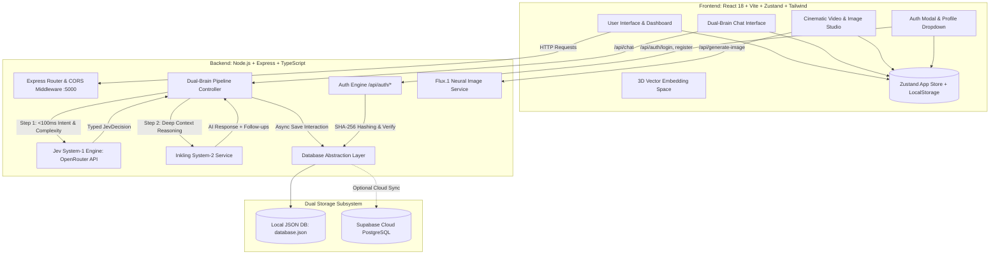

# ONᵉ AI Studio — Steami Cognitive Dual-Brain Platform

> **Next-Generation Dual-Brain AI Creative Studio combining TypeSafe System-1 Typed Decisions (<100ms), Thinking Machines Inkling System-2 Deep Reasoning, Interactive 3D Vector Spaces, Neural Media Synthesis, and Local-First SHA-256 Authentication.**

---

## 🌟 Executive Overview

**ONᵉ AI Studio** is a unified AI production workspace designed for digital artists, creative directors, and prompt architects. Built around the dual-process cognitive theory of human thought, the platform pairs instantaneous decision-making heuristics with deep reasoning models:

1. **System 1 (Jev — TypeSafe AI):** Executes sub-100ms intent classification, semantic confidence calibration, and structured decision primitives (`noul` truth-scoring and multi-choice probabilistic routing).
2. **System 2 (Inkling — Thinking Machines Lab):** Handles deep multi-step reasoning, cinematic scriptwriting, creative worldbuilding, and 1M token context generation.
3. **3D User Vector Embedding Space:** An interactive 3-axis coordinate space that dynamically visualizes the semantic proximity of user queries against vector knowledge clusters in real time.
4. **Cinematic Directing Studio:** Virtual 3D camera rig controls, multi-shot storyboard sequencing, spatial node graph canvas, LUT color grading, and an ambient Web Audio synthesizer.
5. **Neural Image Generation Engine:** Flux.1 and Imagen-3 diffusion pipelines with prompt enhancement, seed reproducibility, and 4K neural super-resolution upscaling.
6. **Local-First Authentication:** Complete user registration, login, and profile persistence powered by salted SHA-256 cryptographic hashing and local JSON storage with optional Supabase cloud sync.

---

## 🏛️ System Architecture



---

## 🚀 Key Modules & Capabilities

### 1. Dual-Brain Execution Pipeline
When a user submits a prompt, the request undergoes a two-stage cognitive pipeline:
- **Fast System-1 Classification (`evaluateWithJev`):**
  - Evaluates user intent, complexity score (`simple`, `moderate`, `deep`), reasoning budget (`low`, `medium`, `high`), and latency.
  - Generates typed decision primitives:
    - **`noul` primitive:** Calculates empirical truth scores (0–100%) and categorizes inquiries as `TRUE`, `FALSE`, or `CONTESTED / AMBIGUOUS`.
    - **`choice` primitive:** Calculates winning choices among discrete alternatives with probability distributions.
- **Deep System-2 Reasoning (`generateWithInkling`):**
  - Consumes the prompt along with the Jev telemetry metadata to synthesize nuanced, context-aware cinematic responses, scene breakdowns, and actionable next steps.

---

### 2. Interactive 3D User Vector Embedding Space
Located on the main dashboard ([UserVectorEmbeddingSpace.tsx](file:///c:/Users/Prat1/OneDrive/Desktop/ONe/frontend/src/components/dashboard/UserVectorEmbeddingSpace.tsx)):
- **3D Coordinate Plane:** Rendered with isometric projection featuring **Latent Dimension (Semantic)** vertical axis (blue arrow), **Feature Vector A & B** axes, and a perspective floor grid.
- **Real-Time Dynamic Clustering:** Searches and prompts entered by the user are immediately embedded as green glowing nodes.
- **Query Proximity Anchor:** The active query appears as a dedicated query center with expanding radar concentric rings, dynamically linking to the closest semantic nodes and calculating cosine distance.
- **Telemetry HUD:** Displays active nodes, dimensionality (300D vector projection), and cluster cohesion.

---

### 3. Text-to-Video & Cinematic Directing Suite
- **Virtual 3D Camera Rig:** Sliders for pitch, yaw, distance, focal length (18mm to 135mm), aperture (`f/1.4` to `f/22`), lighting angle, and motion paths (`Orbit`, `Crane`, `Drone`, `DollyZoom`).
- **Multi-Scene Storyboard Editor:** Break down scripts into numbered scenes with precise duration, camera movement vectors, visual notes, and thumbnail previews.
- **Color Grading Suite (LUTs):** Real-time exposure, contrast, saturation, temperature, vignette, film grain, and bloom controls with presets like *Humanon Noir* and *Obsidian Matrix*.
- **Spatial Node Canvas:** Visual node graph linking vision scripts to scenes, camera rigs, audio stems, and LUT processors.
- **Web Audio Foley Synthesizer:** Real-time procedural audio synthesis generating ambient drone frequencies and UI sound feedback.

---

### 4. Text-to-Image Generation & 4K Super-Resolution
- **Flux.1 & Imagen-3 Neural Transformers:** Multi-model generation supporting customizable aspect ratios (`16:9`, `9:16`, `1:1`, `4:5`, `21:9`), CFG scale, seed control, and negative prompts.
- **Cinematic Prompt Enhancer:** Transforms basic concepts into production-ready prompts specifying lenses, lighting color codes, and atmospheric depth.
- **4K Upscaling:** Super-resolution upscaling endpoint for ultra-high-definition exports.

---

### 5. Full-Stack Authentication & Identity System
- **Salted SHA-256 Hashing:** Passwords are never stored in plaintext. They are salted and hashed using Node.js `crypto`.
- **Session Tokens:** Generates base64 session tokens verified via `Bearer` headers.
- **Custom Creator Personas:** Register with custom handles (`@handle`), bios, and creator avatar presets.
- **Quick Demo Sign-In:** Instant 1-click test login for **Alex Vance** (`alex@onestudio.ai` / `password123`).
- **Persistent Navbar State:** Displays user avatar with an active status badge, username, and an interactive menu (Workspace Settings, Sign Out).

---

## 📁 Repository Structure

```
ONe/
├── backend/                       # Express.js + TypeScript Backend Service
│   ├── data/
│   │   └── database.json          # Persistent local JSON database
│   ├── src/
│   │   ├── db/
│   │   │   ├── dbService.ts       # Unified database abstraction layer
│   │   │   ├── localDb.ts         # Local JSON DB CRUD, user management, password hashing
│   │   │   └── supabaseClient.ts  # Supabase PostgreSQL client integration
│   │   ├── imageService.ts        # Flux.1 image generation & dimension math
│   │   ├── inklingService.ts      # Thinking Machines Inkling System-2 agentic reasoning
│   │   ├── jevEngine.ts           # TypeSafe Jev System-1 Decision API integration
│   │   ├── server.ts              # Main Express server and API route handlers
│   │   └── types.ts               # Backend TypeScript data interfaces
│   ├── package.json
│   └── tsconfig.json
│
├── frontend/                      # React 18 + Vite + Tailwind CSS Frontend
│   ├── src/
│   │   ├── components/
│   │   │   ├── chat/              # ChatArea, ChatComposer, ChatMessageItem, ChatSidebar
│   │   │   ├── common/            # AIOrb, AuthModal, CommandPalette, Navbar, Sidebar, etc.
│   │   │   ├── dashboard/         # HeroBanner, UserVectorEmbeddingSpace, Telemetry, etc.
│   │   │   ├── image/             # ImageCanvasPreview, ImageControls, ImagePromptEditor
│   │   │   ├── playground/        # InteractiveParticleCanvas
│   │   │   └── video/             # Director3DViewport, StoryboardEditor, ColorGradingSuite
│   │   ├── data/
│   │   │   └── mockData.ts        # Initial seed projects, styles, inspirations
│   │   ├── layouts/
│   │   │   └── RootLayout.tsx     # Master responsive layout with global background
│   │   ├── pages/
│   │   │   ├── Auth.tsx           # Dedicated /login & /register pages
│   │   │   ├── Chat.tsx           # Dual-Brain conversation page
│   │   │   ├── CreateVideo.tsx    # Text-to-Video directing studio
│   │   │   ├── Creations.tsx      # Video project library and showcase
│   │   │   ├── Explore.tsx        # Community inspiration feed
│   │   │   ├── Home.tsx           # Main studio dashboard
│   │   │   ├── Playground.tsx     # Text-to-Image synthesis laboratory
│   │   │   └── Settings.tsx       # Creator profile & studio preferences
│   │   ├── store/
│   │   │   └── useAppStore.ts     # Global Zustand application state
│   │   ├── styles/
│   │   │   └── index.css          # Tailwind CSS directives & Steam Cyber Glass classes
│   │   ├── types/
│   │   │   └── index.ts           # Frontend TypeScript interfaces (AuthUser, Scene, etc.)
│   │   ├── utils/
│   │   │   └── audioSynth.ts      # Web Audio API ambient sound generator
│   │   ├── App.tsx                # Client-side router configuration
│   │   └── main.tsx               # React application entry point
│   ├── index.html
│   ├── package.json
│   ├── tailwind.config.js
│   ├── tsconfig.json
│   └── vite.config.ts
│
├── start-all.bat                  # 1-Click launcher for both Backend & Frontend
├── start-backend.bat              # Standalone Backend launcher
├── start-frontend.bat             # Standalone Frontend launcher
└── README.md                      # Comprehensive project documentation
```

---

## 📡 Backend REST API Reference

All backend endpoints run on `http://localhost:5000` by default.

### Authentication Endpoints

#### `POST /api/auth/register`
Creates a new user profile with salted SHA-256 hashed password.
- **Request Body:**
  ```json
  {
    "name": "Alex Vance",
    "email": "alex@onestudio.ai",
    "password": "password123",
    "handle": "@alex_creator",
    "avatar": "https://images.unsplash.com/photo-...",
    "bio": "Visual director & digital artist"
  }
  ```
- **Response (`201 Created`):**
  ```json
  {
    "success": true,
    "user": {
      "id": "usr-1795359284745",
      "name": "Alex Vance",
      "email": "alex@onestudio.ai",
      "handle": "@alex_creator",
      "avatar": "https://...",
      "createdAt": "2026-11-22T14:54:44.746Z"
    },
    "token": "one_auth_dXNyLTE3OTUzNTkyODQ3NDU...",
    "message": "Account created successfully"
  }
  ```

#### `POST /api/auth/login`
Authenticates user credentials and returns session token.
- **Request Body:**
  ```json
  {
    "email": "alex@onestudio.ai",
    "password": "password123"
  }
  ```
- **Response (`200 OK`):**
  ```json
  {
    "success": true,
    "user": { ... },
    "token": "one_auth_dXNyLWRlbW8tMToxN...",
    "message": "Logged in successfully"
  }
  ```

#### `GET /api/auth/me`
Retrieves authenticated user profile using session token.
- **Header:** `Authorization: Bearer <token>`
- **Response (`200 OK`):**
  ```json
  {
    "success": true,
    "user": { ... }
  }
  ```

---

### Dual-Brain & Media Endpoints

| Method | Endpoint | Description |
|---|---|---|
| `GET` | `/api/health` | System health check reporting Jev (System 1), Inkling (System 2), and Database connection statuses. |
| `POST` | `/api/chat` | Executes the dual-brain pipeline (Jev intent classification → Inkling deep reasoning). Persists conversation history. |
| `POST` | `/api/jev/evaluate` | Evaluates a raw prompt through Jev System-1 without triggering full Inkling response generation. |
| `POST` | `/api/enhance-prompt` | Transforms a basic user prompt into a high-production cinematic director prompt. |
| `POST` | `/api/generate-image` | Synthesizes neural images via Flux.1 with seed, aspect ratio, and style settings. |
| `POST` | `/api/upscale-image` | 4K super-resolution upscaling for generated frames. |
| `GET` | `/api/db/telemetry` | Returns recent Jev System-1 decisions, latency metrics, and truth score percentiles. |
| `POST` | `/api/daily-task/morning-briefing` | Generates a tactical morning briefing using dual-brain task analysis. |
| `POST` | `/api/daily-task/evening-debrief` | Calculates velocity scores and generates evening retrospectives. |

---

## 🎨 Design System: Steam Cyber Glass

The UI employs a high-contrast dark cyberpunk aesthetic inspired by vintage valve instrumentation, modern digital audio workstations, and obsidian glass:

| Token | Hex Code | Purpose |
|---|---|---|
| **Deep Space Obsidian** | `#171A21` | Global body background with subtle noise & stardust particles |
| **Console Steel** | `#171D25` | Primary card panels, modals, and navbar containers |
| **Elevated Surface** | `#1B2838` | Interactive input fields, button backgrounds, pill badges |
| **Grid Boundary** | `#2A475E` | Subtle borders, dividers, and coordinate grid lines |
| **Cyan Cyber Arc** | `#66C0F4` | Primary brand accent, focus rings, and vector highlight rings |
| **Amber Tungsten** | `#E5A866` | Secondary accent, energy credits, warnings, and heat indicators |
| **Phosphor Green** | `#5C7E10` | Online health indicators and semantic vector nodes |

---

## 🛠️ Installation & Setup

### Prerequisites
- **Node.js**: v18.0.0 or higher
- **npm** or **pnpm**
- **Git**

### 1. Clone the Repository
```bash
git clone https://github.com/your-username/one-ai-studio.git
cd one-ai-studio
```

### 2. Configure Environment Variables
Create a `.env` file in the `backend/` directory:
```env
PORT=5000

# OpenRouter API (Powers Jev System-1 Decisions & Inkling System-2)
OPENROUTER_API_KEY=your_openrouter_api_key_here

# (Optional) Supabase PostgreSQL Cloud Sync
SUPABASE_URL=your_supabase_project_url
SUPABASE_SERVICE_ROLE_KEY=your_supabase_service_role_key
```

### 3. Install Dependencies
```bash
# Backend dependencies
cd backend
npm install

# Frontend dependencies
cd ../frontend
npm install
```

### 4. Running the Development Servers

#### Option A: 1-Click Launch (Windows)
Double-click `start-all.bat` in the root folder, or run in terminal:
```powershell
.\start-all.bat
```

#### Option B: Manual Command Line
Open two terminal windows:

**Terminal 1 (Backend):**
```bash
cd backend
npm run dev
# Server running at http://localhost:5000
```

**Terminal 2 (Frontend):**
```bash
cd frontend
npm run dev
# Vite client running at http://localhost:5173
```

---

## 🧪 Testing & Verification

### Verify Frontend Production Build
```bash
cd frontend
npm run build
```

### Test Backend Health & Auth API (PowerShell)
```powershell
# 1. Health check
Invoke-RestMethod -Uri 'http://localhost:5000/api/health' | ConvertTo-Json -Depth 3

# 2. Login as Alex Vance
$body = @{ email = 'alex@onestudio.ai'; password = 'password123' } | ConvertTo-Json
Invoke-RestMethod -Uri 'http://localhost:5000/api/auth/login' -Method POST -ContentType 'application/json' -Body $body | ConvertTo-Json -Depth 3
```

---

## 🤝 Pre-Seeded Demo Credentials

For quick exploration of the platform:
- **Email:** `alex@onestudio.ai`
- **Password:** `password123`
- *Alternatively, click **"⚡ Quick Demo Login (Alex Vance)"** in the Sign In modal to log in with a single click.*

---

## 💡 Acknowledgements & Technologies
- **TypeSafe AI** — Jev System-1 Typed Decisions & Classification
- **Thinking Machines Lab** — Inkling System-2 Agentic Deep Reasoning
- **OpenRouter** — High-speed API Gateway for decision primitives
- **Flux.1 & Black Forest Labs** — Neural text-to-image synthesis
- **Tailwind CSS & Lucide Icons** — Cyber steam UI design components
- **Vite & React** — Ultra-fast frontend rendering architecture